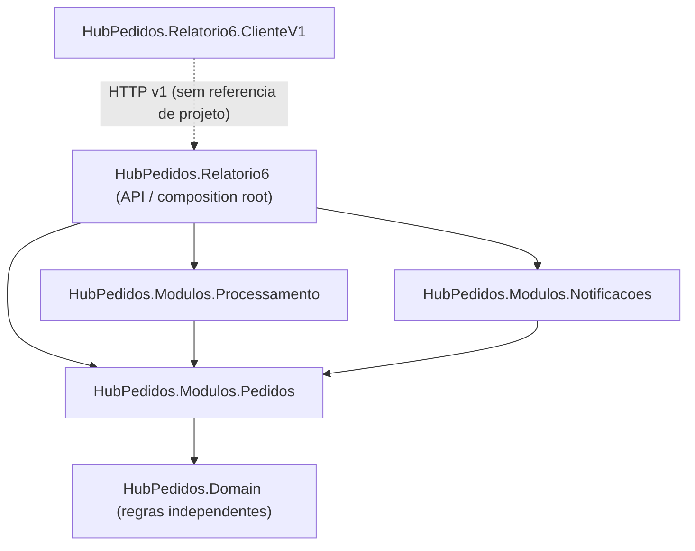

# R6.01 – Grafo de modulos (referencias reais de projeto)

Verificacao: `dotnet list <projeto.csproj> reference` e testes de referencia entre assemblies.
O projeto **Domain** nao deve referenciar a API, a infraestrutura nem EF Core.
A infraestrutura dos relatorios anteriores continua preservada; este exemplo usa repositorio em memoria somente em R6.
